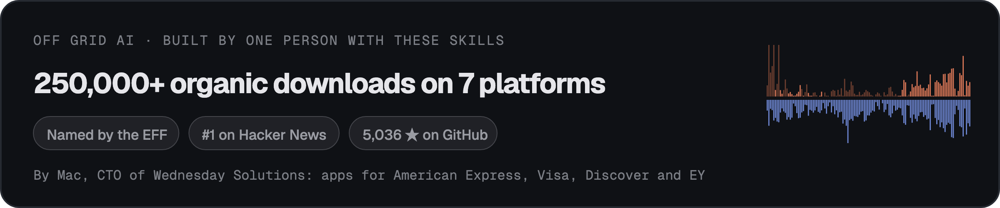
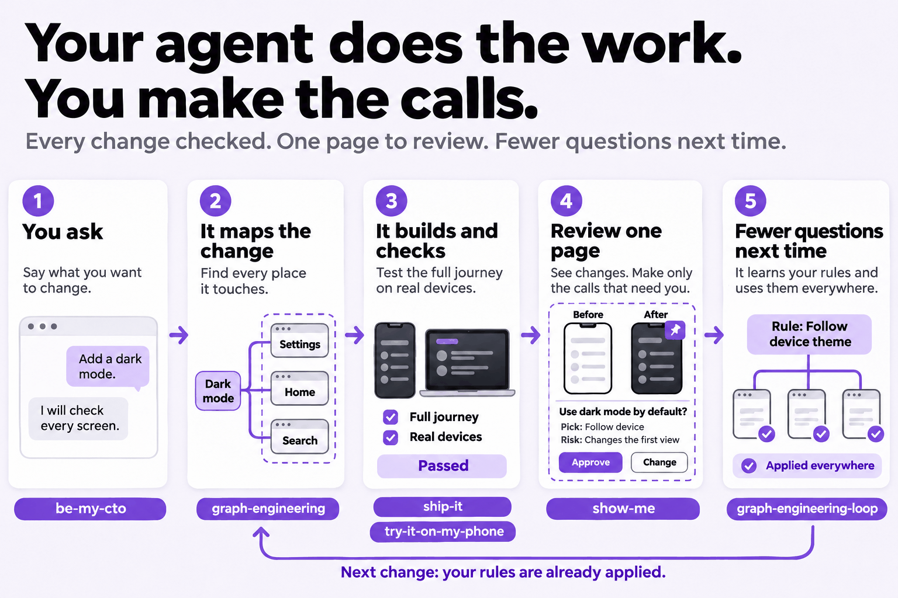

# Stop babysitting your AI. Make it build, test and ship like a senior team.

42 free skills for Claude Code, Codex, Cursor and 60+ other agents. Install them with one line, and your AI starts checking its own work.

- **[Review like a senior engineer, without reading code](01-review-like-a-senior-engineer)**. Your AI changes 50 files and you can't tell what broke. Now you get one page with every screen it touched, before and after, and only the calls that need you.
- **[Your AI stops breaking things that already worked](02-your-ai-stops-breaking-things)**. You fix one bug and two old features break. Now every change is tested by tapping through your app like a real user, with no fake mocks hiding the breakage.
- **[UI that looks like Stripe's designers made it](03-ui-that-looks-like-stripe-made-it)**. Vibe-coded apps all look the same. Now every screen clears a real design bar, reuses your best components, and one fix lands on every screen.
- **[An AI that thinks like your CTO](04-an-ai-that-thinks-like-a-cto)**. No CTO? Your AI becomes one. It decides what's urgent, argues back when you're wrong, builds while you sleep, and never loses where you left off.
- **[Launch like a real startup](05-launch-like-a-real-startup)**. It worked on your laptop and broke on your phone. Now every release is tested on real phones, shipped cleanly, and announced in notes people read.
- **[Get users without ads](06-get-users-without-ads)**. Your landing page reads like ChatGPT wrote it and nobody can find you. Now your copy sounds human, sells, and gets you recommended in AI answers.
- **[Know what makes you money](07-know-what-makes-you-money)**. You have Stripe, analytics and store numbers and no idea what to change. Now you get the three moves that grow revenue most, and decisions you can make from one page.
- **[Make a game like a studio would](08-make-a-game-like-a-studio)**. Making a game alone with AI? Now it has a director, an art director and a QA team that playtests every scene.

[](https://github.com/alichherawalla)



## Install in one line

Paste this into your agent:

```text
Install the skills from github.com/off-grid-ai/skills
```

Or run it yourself:

```bash
npx skills add off-grid-ai/skills
```

<details>
<summary>Other ways: Claude Code plugin, Codex plugin, no Node</summary>

**Claude Code**
```text
/plugin marketplace add off-grid-ai/skills
/plugin install review-like-a-senior-engineer@off-grid-ai
```

**Codex**
```bash
codex plugin marketplace add off-grid-ai/skills
codex plugin add review-like-a-senior-engineer@off-grid-ai
```

Plugin names: `review-like-a-senior-engineer`, `your-ai-stops-breaking-things`, `ui-that-looks-like-stripe-made-it`, `an-ai-that-thinks-like-a-cto`, `launch-like-a-real-startup`, `get-users-without-ads`, `know-what-makes-you-money`, `make-a-game-like-a-studio`.

**Any agent, no Node**
```bash
curl -fsSL https://raw.githubusercontent.com/off-grid-ai/skills/main/install.sh | bash
```
It links every skill into each agent it finds on your machine. Run it again to update.

</details>

## Try these first

**[graph-engineering](01-review-like-a-senior-engineer/graph-engineering): review a 98-screen change on one page.** Ask for one change and you see every place it touches, every changed screen before and after, and only the calls that need you. [graph-engineering-loop](01-review-like-a-senior-engineer/graph-engineering-loop) learns the rule behind each call and applies it everywhere.


> *"Use graph-engineering to rename Folders to Projects across the app."*

**[test-like-a-user](02-your-ai-stops-breaking-things/test-like-a-user): tests that catch what your users would hit.** It opens the real screen, taps the real button and checks what you'd see. No mocks of your own code, so a green test means it really works.

> *"/test-like-a-user the checkout flow"*

**[argue-with-me](04-an-ai-that-thinks-like-a-cto/argue-with-me): an AI that tells you when you're wrong.** It checks the facts and keeps your whole goal in view instead of agreeing with whatever you said last.

> *"/argue-with-me we should rewrite the backend in Rust"*

**[resume-any-chat](04-an-ai-that-thinks-like-a-cto/resume-any-chat): never lose a chat again.** Find any past session by its name, even from another account or from Codex, and carry on where it stopped.

> *"/resume-any-chat the onboarding redesign"*

## All 42 skills

### [Review like a senior engineer, without reading code](01-review-like-a-senior-engineer)

Your AI changes 50 files and you can't tell what broke. Now you get one page with every screen it touched, before and after, and only the calls that need you.


| Skill | What you get |
| --- | --- |
| [**graph-engineering**](01-review-like-a-senior-engineer/graph-engineering) | Ask for one change. See every place it touches, every screen before and after, on one page. |
| [**graph-engineering-loop**](01-review-like-a-senior-engineer/graph-engineering-loop) | Answer a few calls once. It learns your rule, applies it everywhere, and asks you less next time. |
| [**show-me**](01-review-like-a-senior-engineer/show-me) | Every screen of your app on one page. Pin a note on the exact spot, like Figma comments. |
| [**safe-to-merge**](01-review-like-a-senior-engineer/safe-to-merge) | Your pull request gets every review comment answered and fixed until it's safe to merge. |
| [**code-check**](01-review-like-a-senior-engineer/code-check) | A pass or fail on every change before it ships, against one clear bar. |
| [**never-twice**](01-review-like-a-senior-engineer/never-twice) | Every review teaches your AI, so the same mistake never comes back. |

### [Your AI stops breaking things that already worked](02-your-ai-stops-breaking-things)

You fix one bug and two old features break. Now every change is tested by tapping through your app like a real user, with no fake mocks hiding the breakage.


| Skill | What you get |
| --- | --- |
| [**test-like-a-user**](02-your-ai-stops-breaking-things/test-like-a-user) | Tests that open the real screen, tap the real button and check what you'd see. No mocks of your own code. |
| [**bug-trap**](02-your-ai-stops-breaking-things/bug-trap) | Every bug gets a test that fails first, so it can't sneak back in. |
| [**dont-break-it**](02-your-ai-stops-breaking-things/dont-break-it) | Your AI changes, checks and saves code so nothing half-done ships. |
| [**fix-it-for-real**](02-your-ai-stops-breaking-things/fix-it-for-real) | It fixes the cause, not the symptom, and reuses what someone already solved. |
| [**click-everything**](02-your-ai-stops-breaking-things/click-everything) | It clicks through every page of your web app and fixes what breaks. |

### [UI that looks like Stripe's designers made it](03-ui-that-looks-like-stripe-made-it)

Vibe-coded apps all look the same. Now every screen clears a real design bar, reuses your best components, and one fix lands on every screen.


| Skill | What you get |
| --- | --- |
| [**make-it-look-expensive**](03-ui-that-looks-like-stripe-made-it/make-it-look-expensive) | A design bar every screen has to clear before you see it: spacing, states, motion, polish. |
| [**match-the-design**](03-ui-that-looks-like-stripe-made-it/match-the-design) | It builds from your component library with its animations, so no screen looks one-off. |
| [**fix-it-everywhere**](03-ui-that-looks-like-stripe-made-it/fix-it-everywhere) | Leave notes on 3 screens. It turns them into one rule and fixes every screen. |

### [An AI that thinks like your CTO](04-an-ai-that-thinks-like-a-cto)

No CTO? Your AI becomes one. It decides what's urgent, argues back when you're wrong, builds while you sleep, and never loses where you left off.


| Skill | What you get |
| --- | --- |
| [**be-my-cto**](04-an-ai-that-thinks-like-a-cto/be-my-cto) | Your AI decides what's urgent, does the clear work, and only asks you the real calls. |
| [**build-while-you-sleep**](04-an-ai-that-thinks-like-a-cto/build-while-you-sleep) | Several AI builders work at once while one checks everything that lands. |
| [**argue-with-me**](04-an-ai-that-thinks-like-a-cto/argue-with-me) | Your AI argues back with facts instead of agreeing with your worst ideas. |
| [**resume-any-chat**](04-an-ai-that-thinks-like-a-cto/resume-any-chat) | Pick up any past chat by its name and carry on. Works across Claude Code accounts and Codex. |
| [**no-fluff**](04-an-ai-that-thinks-like-a-cto/no-fluff) | Short answers, result first, no essays. |

### [Launch like a real startup](05-launch-like-a-real-startup)

It worked on your laptop and broke on your phone. Now every release is tested on real phones, shipped cleanly, and announced in notes people read.


| Skill | What you get |
| --- | --- |
| [**ship-it**](05-launch-like-a-real-startup/ship-it) | Take any feature all the way to live: built, tested, seen working. |
| [**try-it-on-my-phone**](05-launch-like-a-real-startup/try-it-on-my-phone) | Your AI checks every release on real phones before your users do. |
| [**run-on-any-device**](05-launch-like-a-real-startup/run-on-any-device) | Your AI runs and taps through your app on a computer, an iPhone and an Android phone. |
| [**release-day**](05-launch-like-a-real-startup/release-day) | Clean releases with screenshots on every pull request. |
| [**whats-new**](05-launch-like-a-real-startup/whats-new) | Release notes your users actually read. |

### [Get users without ads](06-get-users-without-ads)

Your landing page reads like ChatGPT wrote it and nobody can find you. Now your copy sounds human, sells, and gets you recommended in AI answers.


| Skill | What you get |
| --- | --- |
| [**make-it-sell**](06-get-users-without-ads/make-it-sell) | Headlines and landing pages that sell, on the rules of the best ad writers ever. |
| [**sound-human**](06-get-users-without-ads/sound-human) | Copy that sounds like a person wrote it, with zero AI tells. |
| [**write-like-me**](06-get-users-without-ads/write-like-me) | Posts and emails in your own voice, learned from what you've already written. |
| [**get-cited-by-ai**](06-get-users-without-ads/get-cited-by-ai) | Articles that rank on Google and get you named in ChatGPT-style answers. |
| [**find-threads-to-join**](06-get-users-without-ads/find-threads-to-join) | The posts worth your reply each day, with two angles ready for each. |

### [Know what makes you money](07-know-what-makes-you-money)

You have Stripe, analytics and store numbers and no idea what to change. Now you get the three moves that grow revenue most, and decisions you can make from one page.


| Skill | What you get |
| --- | --- |
| [**grow-my-revenue**](07-know-what-makes-you-money/grow-my-revenue) | Connect Stripe and your analytics. Get the three moves that grow revenue most. |
| [**help-me-decide**](07-know-what-makes-you-money/help-me-decide) | Any big decision on one page: the answer first, every claim sourced, options scored. |
| [**weekly-wins**](07-know-what-makes-you-money/weekly-wins) | What you shipped this week against last week, and what's next. |
| [**pick-the-best-ai-model**](07-know-what-makes-you-money/pick-the-best-ai-model) | The best AI models for your app on every device, backed by public benchmarks. |
| [**mission-control**](07-know-what-makes-you-money/mission-control) | One page of everything in flight across your projects, with what needs you on top. |

### [Make a game like a studio would](08-make-a-game-like-a-studio)

Making a game alone with AI? Now it has a director, an art director and a QA team that playtests every scene.


| Skill | What you get |
| --- | --- |
| [**game-director**](08-make-a-game-like-a-studio/game-director) | Your AI runs the game like a director: what's fun, what's urgent, what waits. |
| [**art-director**](08-make-a-game-like-a-studio/art-director) | Every screen, scene and animation held to one look. |
| [**playtest**](08-make-a-game-like-a-studio/playtest) | It plays through every scene and hands you a pass or fail with pictures. |
| [**ship-the-feature**](08-make-a-game-like-a-studio/ship-the-feature) | Any game feature taken all the way: built, seen working, pushed, shown. |
| [**prove-it**](08-make-a-game-like-a-studio/prove-it) | Proof a change works, with compile checks and renders. |
| [**boot-game**](08-make-a-game-like-a-studio/boot-game) | Your whole game stack started in the right order, every time. |
| [**devlog**](08-make-a-game-like-a-studio/devlog) | Push, document and show off your progress. |
| [**game-calls**](08-make-a-game-like-a-studio/game-calls) | Straight answers when you're making game decisions. |

## Good to know

- Each skill is a folder with a `SKILL.md`, plain Markdown your agent reads when your request matches it. Nothing runs until you ask.
- Review pages publish as Claude Artifacts when you have them, and as a local HTML page when you don't.
- Skills mention each other by name. Install the whole set to get everything working together.
- MIT licensed. Third-party files keep their own licenses (see `NOTICE` files).

Made by [Mac](https://github.com/alichherawalla). Follow me on GitHub for new skills as they ship.
