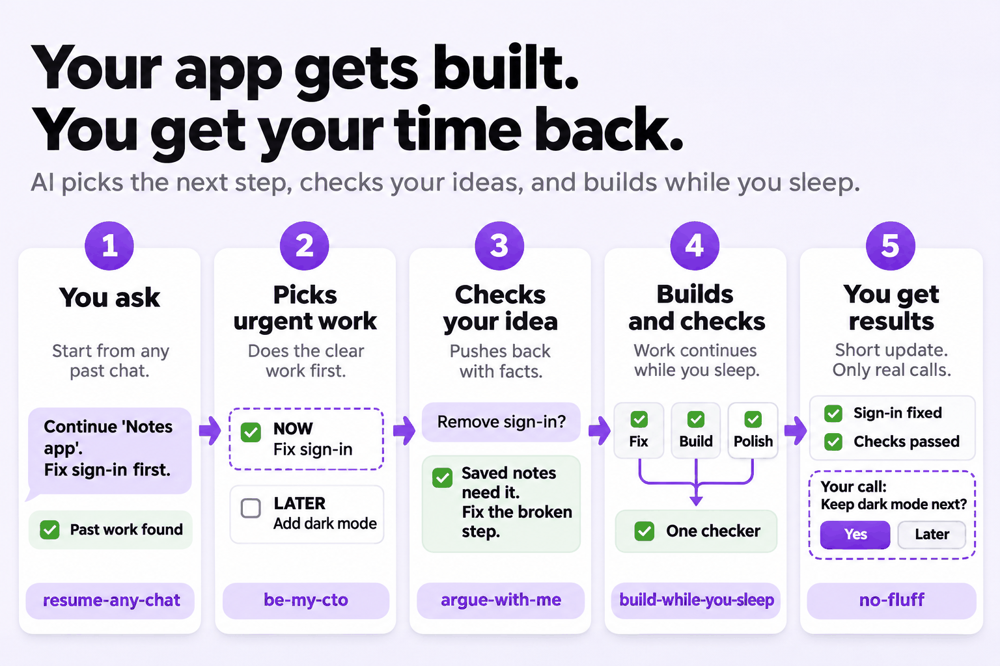

# An AI that thinks like your CTO

No CTO? Your AI becomes one. It decides what's urgent, argues back when you're wrong, builds while you sleep, and never loses where you left off.



| Skill | What you get |
| --- | --- |
| [**be-my-cto**](be-my-cto) | Your AI decides what's urgent, does the clear work, and only asks you the real calls. |
| [**build-while-you-sleep**](build-while-you-sleep) | Several AI builders work at once while one checks everything that lands. |
| [**argue-with-me**](argue-with-me) | Your AI argues back with facts instead of agreeing with your worst ideas. |
| [**resume-any-chat**](resume-any-chat) | Pick up any past chat by its name and carry on. Works across Claude Code accounts and Codex. |
| [**no-fluff**](no-fluff) | Short answers, result first, no essays. |

## Install just this set

```bash
npx skills add off-grid-ai/skills --skill be-my-cto build-while-you-sleep argue-with-me resume-any-chat no-fluff
```

Claude Code: `/plugin marketplace add off-grid-ai/skills` then `/plugin install cto@off-grid-ai`.
Codex: `codex plugin marketplace add off-grid-ai/skills` then `codex plugin add cto@off-grid-ai`.

[All skills](../README.md)
