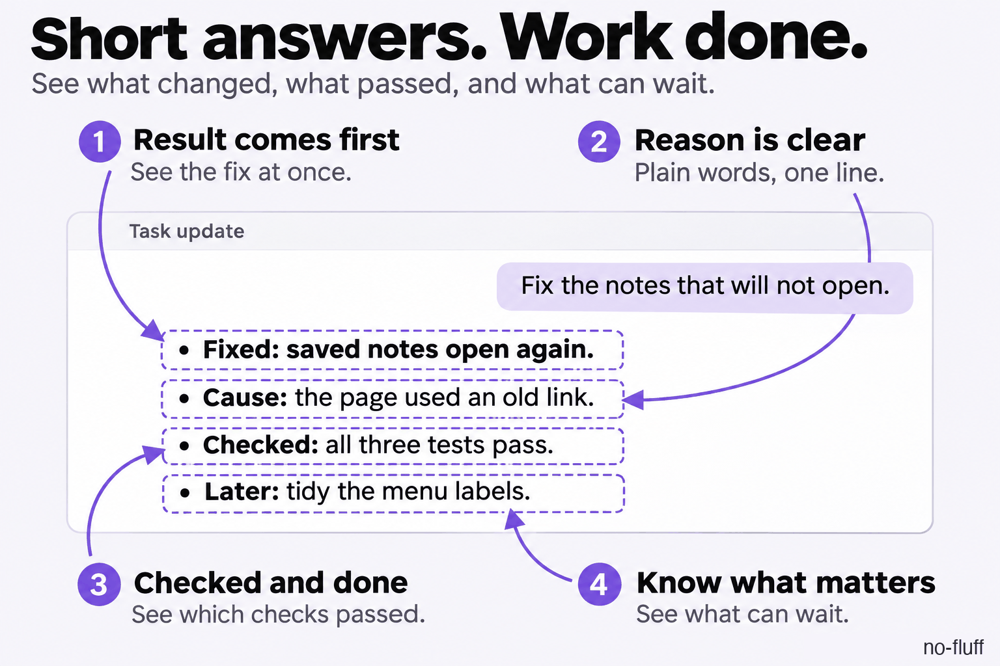

# Get short, straight answers from your agent

Your agent answers in three or four plain lines with the result first, does clear work without asking, and treats only real emergencies as urgent.

Use it when:
- Replies are long and you have to dig for the point.
- The agent keeps asking permission for obvious next steps.
- Everything gets flagged as urgent and you can't tell what matters.

Try it: "/no-fluff then tell me what's left before we can ship."
