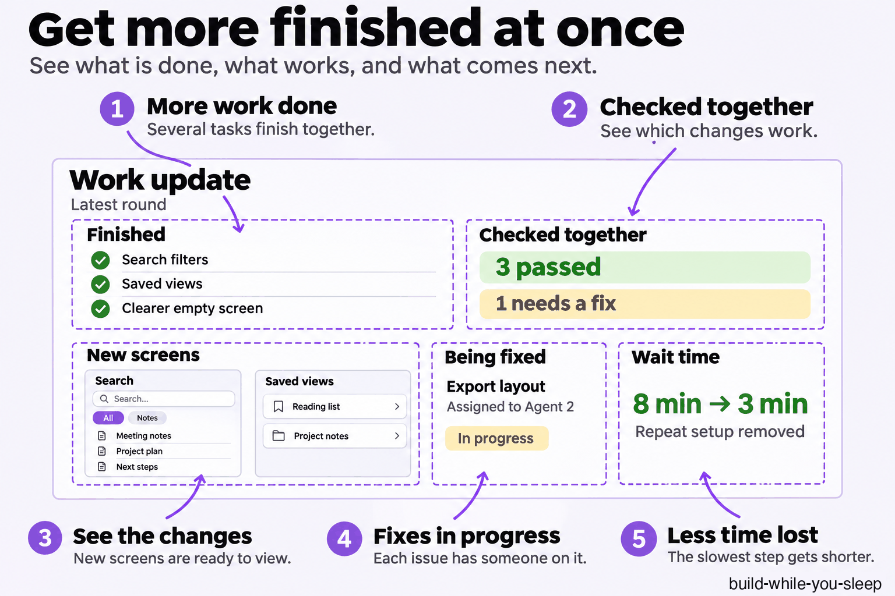

# Run several agents at once without them waiting on each other

Builders write code in one shared tree and never stop to test. A supervisor tests everything that landed together every few minutes, sends failures back to their owners, and removes the biggest bottleneck each round.

Use it when:
- You have several agents on one project and progress feels slow.
- Agents spend more time running tests than writing code.
- You want to know what is actually holding the work up, with numbers.

Try it: "/build-while-you-sleep. Three builders on the checkout, settings and search pieces; you supervise every 12 minutes."
