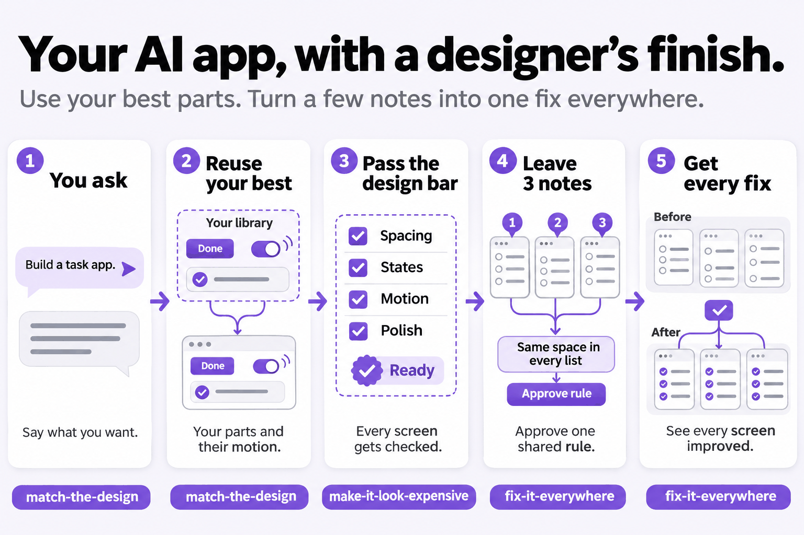

# UI that looks like Stripe's designers made it

Most vibe-coded apps look the same. Every screen has to clear a real design bar and reuse your best components, and a note on one screen fixes all of them.



| Skill | What you get |
| --- | --- |
| [**make-it-look-expensive**](make-it-look-expensive) | A design bar every screen has to clear before you see it: spacing, states, motion, polish. |
| [**match-the-design**](match-the-design) | It builds from your component library with its animations, so no screen looks one-off. |
| [**fix-it-everywhere**](fix-it-everywhere) | Leave notes on 3 screens. It turns them into one rule and fixes every screen. |

## Install just this set

```bash
npx skills add off-grid-ai/skills --skill make-it-look-expensive match-the-design fix-it-everywhere
```

Claude Code: `/plugin marketplace add off-grid-ai/skills` then `/plugin install design@off-grid-ai`.
Codex: `codex plugin marketplace add off-grid-ai/skills` then `codex plugin add design@off-grid-ai`.

[All skills](../README.md)
