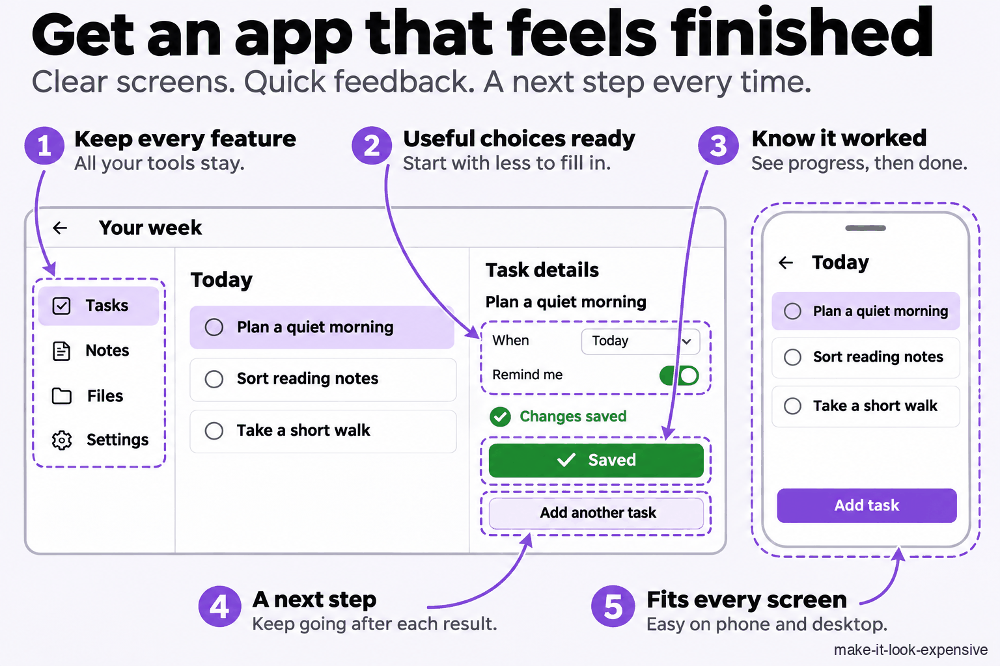

# Hold every screen to the bar of a mature consumer app

An eleven-point product bar your agent applies to every screen, flow and feature: nothing lost, no dead ends, smart defaults, and instant feedback on every tap.

**Use it when**

- Your agent builds or changes a screen or flow.
- You review a feature and want to know what is missing.
- Things work but feel half-built.

**Try it:** "Review the checkout flow against the product bar and fix what falls short."
