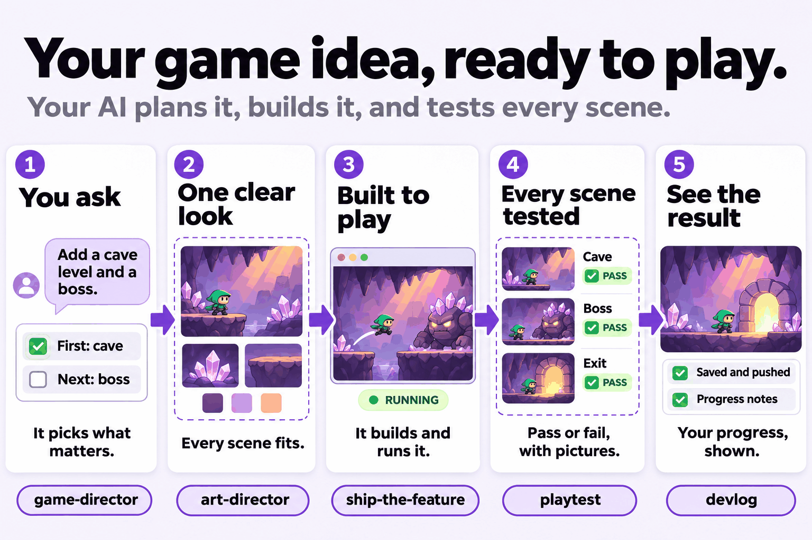

# Make a game like a studio would

Making a game alone with AI? You get a director, an art director and a QA team that playtests every scene.



| Skill | What you get |
| --- | --- |
| [**game-director**](skills/game-director) | Your AI runs the game like a director: what's fun, what's urgent, what waits. |
| [**art-director**](skills/art-director) | Every screen, scene and animation held to one look. |
| [**playtest**](skills/playtest) | It plays through every scene and hands you a pass or fail with pictures. |
| [**ship-the-feature**](skills/ship-the-feature) | Any game feature taken all the way: built, seen working, pushed, shown. |
| [**prove-it**](skills/prove-it) | Proof a change works, with compile checks and renders. |
| [**boot-game**](skills/boot-game) | Your whole game stack started in the right order, every time. |
| [**devlog**](skills/devlog) | Push, document and show off your progress. |
| [**game-calls**](skills/game-calls) | Straight answers when you're making game decisions. |

## Install just this set

```bash
npx skills add off-grid-ai/skills --skill game-director art-director playtest ship-the-feature prove-it boot-game devlog game-calls
```

Claude Code: `/plugin marketplace add off-grid-ai/skills` then `/plugin install off-grid-games@off-grid-ai`.
Codex: `codex plugin marketplace add off-grid-ai/skills` then `codex plugin add off-grid-games@off-grid-ai`.

Some of these skills call skills in other sets. To get everything working together, install every set (see the main README).

[All skills](../README.md)
