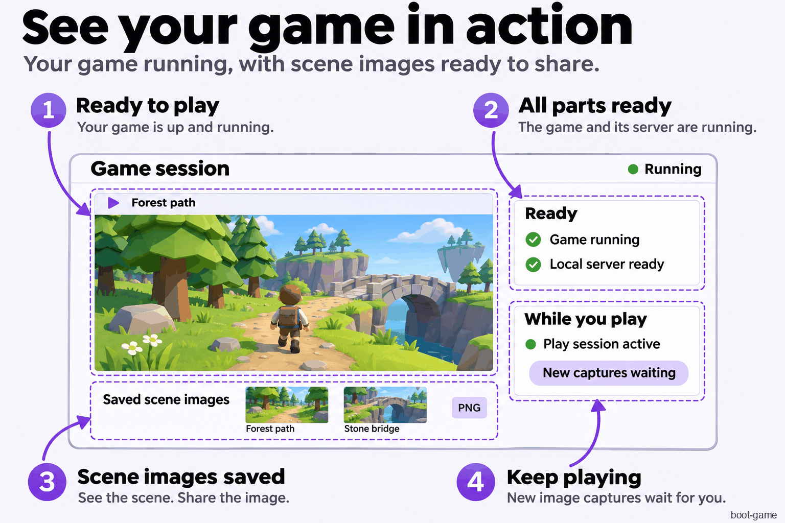

# Run your game and take screenshots from the command line

Your agent finds how your game starts, runs it on the right engine build, and takes screenshot renders of any scene. It shares the GPU safely with you and other agent sessions.

Use it when:
- The agent needs to run or render your game for the first time.
- Several agent sessions work on one machine and fight over the GPU.
- Timings look wrong and you suspect the wrong engine build or a busy machine.

Try it: "Start the game and take a screenshot of the main menu and the first level."
