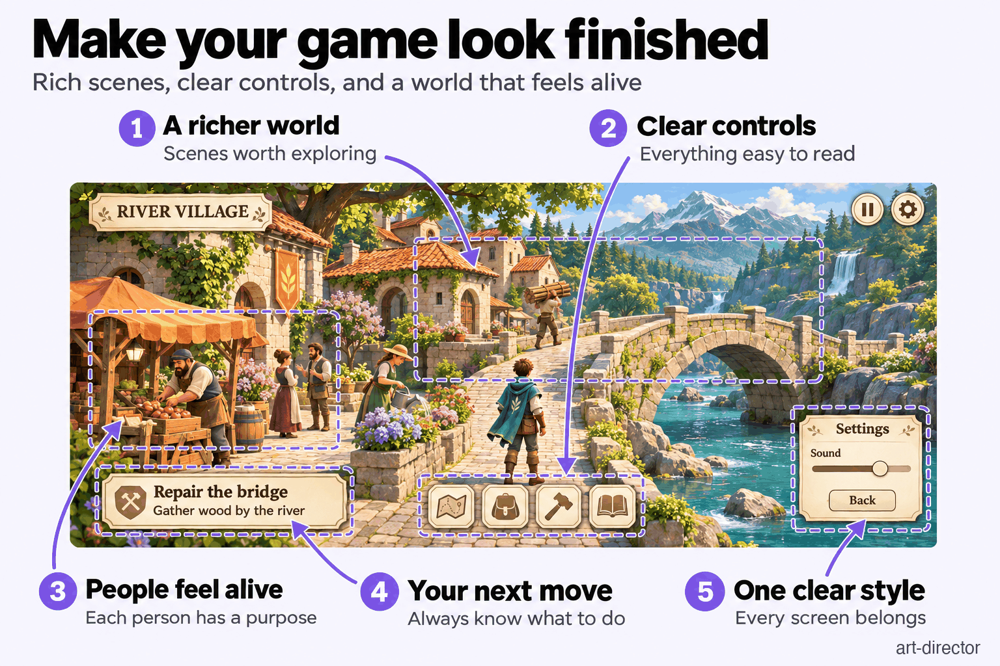

# Make your game look and feel like a polished shipped game

Your agent holds every screen, scene and animation to the bar you set from reference games. No half-built menus, no characters looping one clip, no robotic copy.

Use it when:
- A scene works but looks cheap or stiff.
- You are building a new menu, HUD or camera.
- You want problems shown as marks on screenshots, not paragraphs.

Try it: "Review the market scene against our art target and mark what looks cheap."
