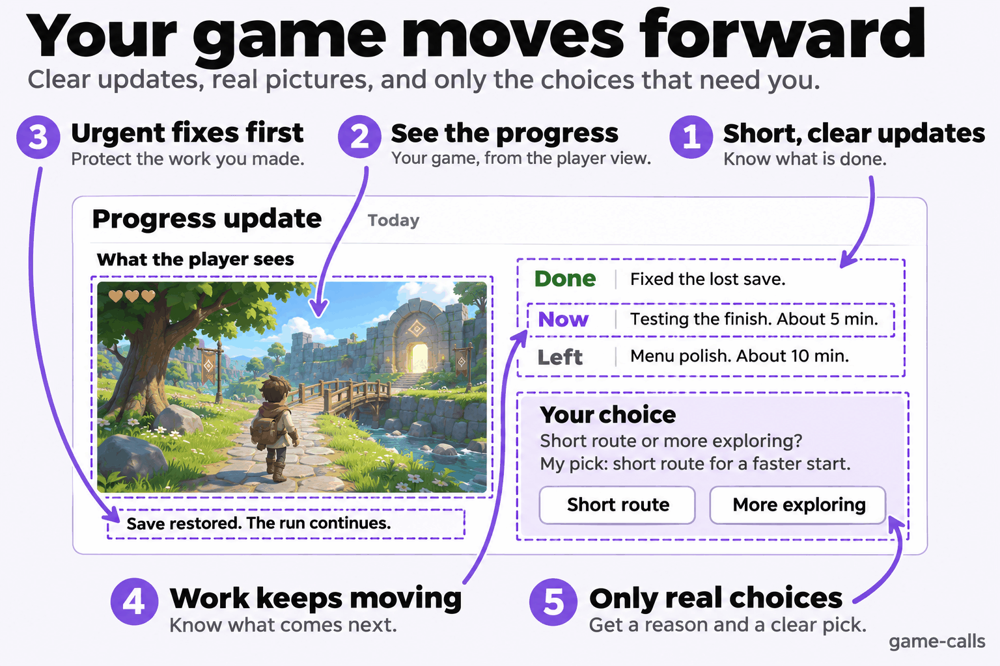

# Short updates, clear calls, fewer questions

Your agent reports in three or four short bullets with the result first, sends pictures instead of descriptions, and keeps working on its own. It only stops to ask at a real fork.

Use it when:
- Your agent writes long updates you don't read.
- It asks permission for things it could just do.
- You want it to sort "fix now" from "put on the list".

Try it: "Keep going on the save system and give me a short status with screenshots when it works."
