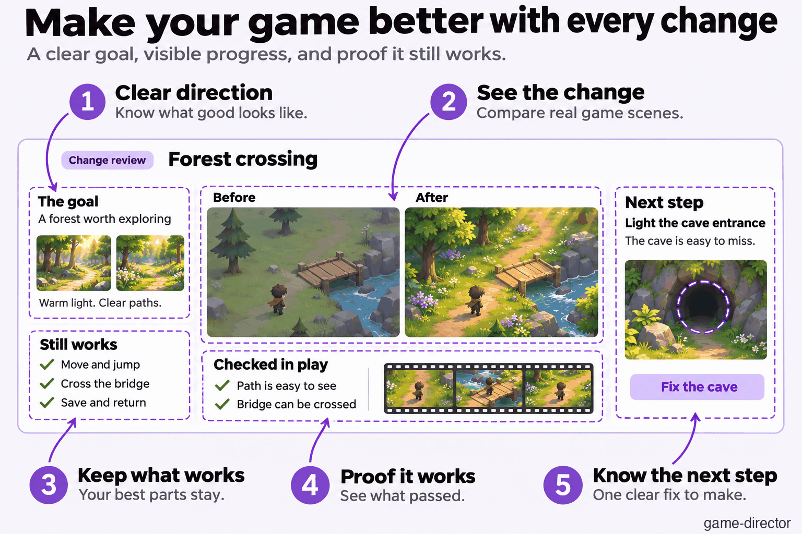

# Run your game project like a director who holds the bar

Your agent works to a written bar for how the game plays and looks, never drops a feature to fix a bug, and builds on engine parts instead of hand-made systems. It loads the other game skills as the work needs them.

Use it when:
- You start real work on a game with an agent.
- Several agent sessions work on one game at once.
- The same bugs keep coming back because each system was hand-built.

Try it: "Act like a game director and plan the next week of work on my game."
