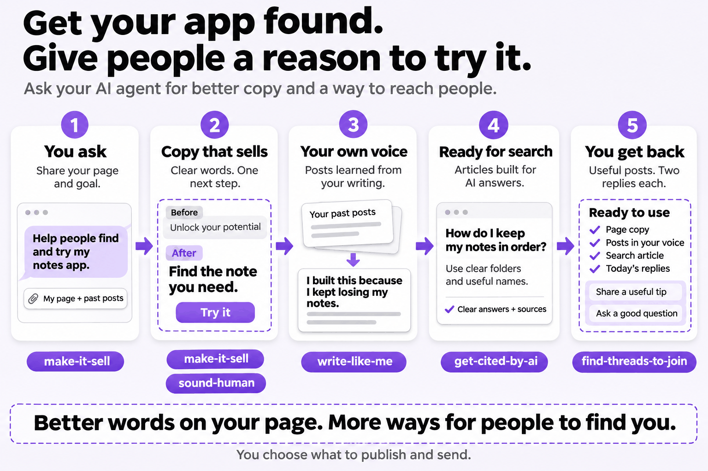

# Get users without ads

Your landing page reads like ChatGPT wrote it. With these, your copy sounds like a person, it sells, and AI search starts naming you.



| Skill | What you get |
| --- | --- |
| [**make-it-sell**](make-it-sell) | Headlines and landing pages that sell, built on the rules Ogilvy and Bly wrote down. |
| [**sound-human**](sound-human) | Copy that sounds like a person wrote it, with zero AI tells. |
| [**write-like-me**](write-like-me) | Posts and emails in your own voice, learned from what you've already written. |
| [**get-cited-by-ai**](get-cited-by-ai) | Articles that rank on Google and get you named in ChatGPT-style answers. |
| [**find-threads-to-join**](find-threads-to-join) | The posts worth your reply each day, with two angles ready for each. |

## Install just this set

```bash
npx skills add off-grid-ai/skills --skill make-it-sell sound-human write-like-me get-cited-by-ai find-threads-to-join
```

Claude Code: `/plugin marketplace add off-grid-ai/skills` then `/plugin install growth@off-grid-ai`.
Codex: `codex plugin marketplace add off-grid-ai/skills` then `codex plugin add growth@off-grid-ai`.

[All skills](../README.md)
