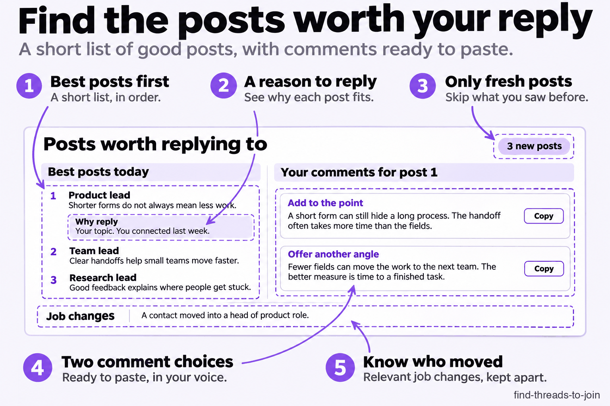

# Find the few posts worth your comment today

Your agent reads the posts from the people you track, drops the ceremonial ones, and ranks the few where you can add something real, warmest relationships first. Each comes with two ready-to-paste comments in your voice, plus a separate list of who moved jobs.

Use it when:
- You want to stay visible on LinkedIn or X without scrolling for an hour.
- Your feed is full of welcomes and awards and you can't find the posts worth replying to.
- You track a list of people and want to know the warmest moment to show up.

Try it: "/find-threads-to-join from my latest scraper run"
