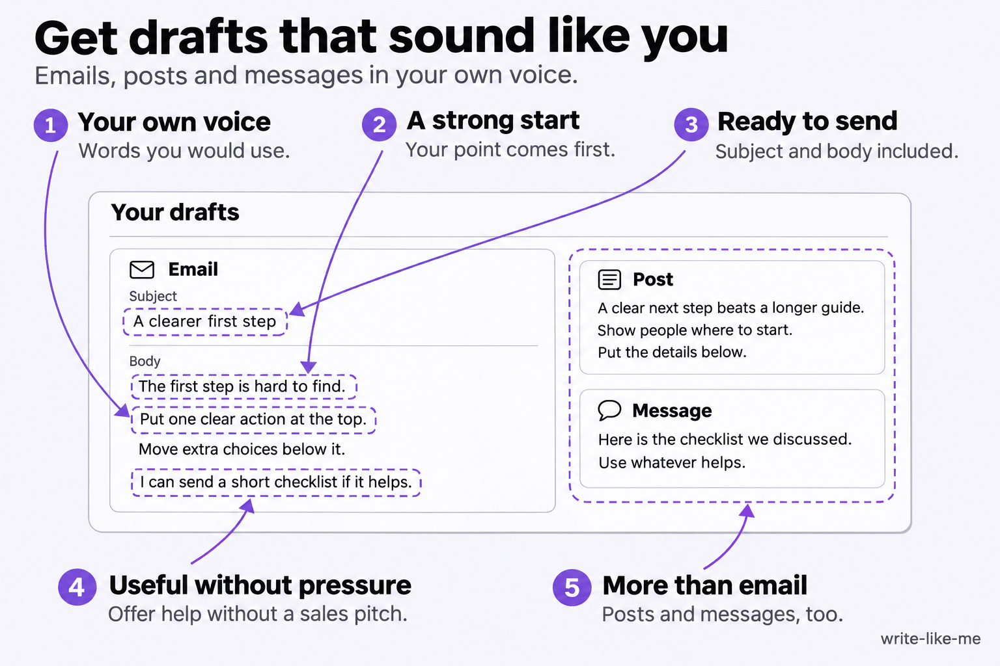

# Get emails and posts that sound like you wrote them

Your agent learns your voice from your own past writing, then drafts outreach in it: the right posture for the message, your sentence habits, and a hard audit for AI tells and needy asks before you see a word.

Use it when:
- You send cold or warm emails, LinkedIn DMs or posts under your own name.
- Drafts from your agent sound polite and generic, not like you.
- You want relationship notes that give value instead of asking for a meeting.

Try it: "/write-like-me Here are 15 of my old LinkedIn posts. Learn my voice, then draft a note to a CTO I met last week."
