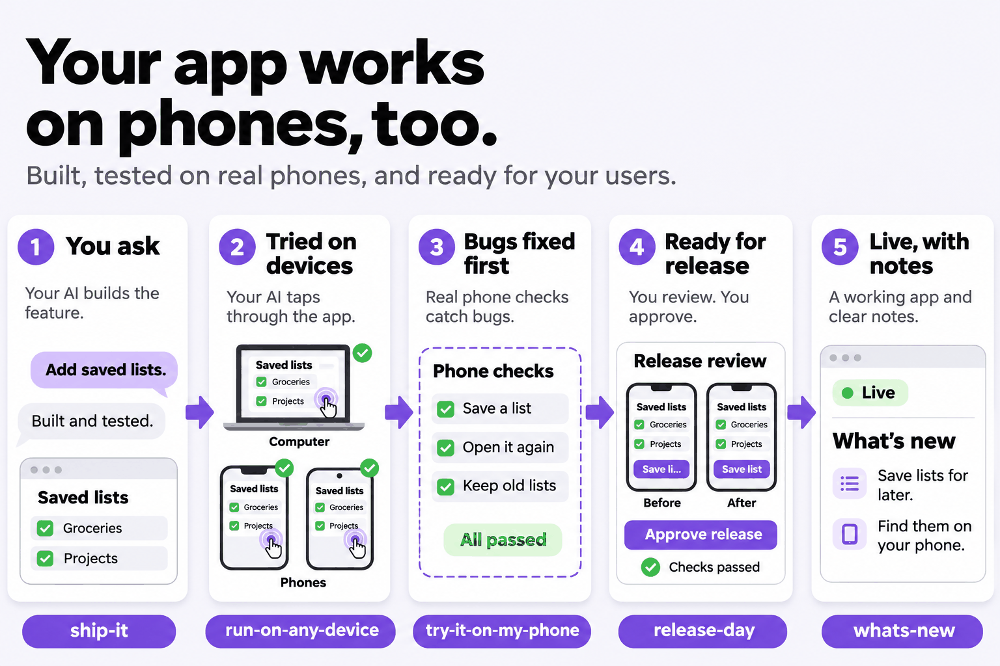

# Launch like a real startup

It worked on your laptop and broke on your phone. Every release gets tried on real phones first, then ships with notes people actually read.



| Skill | What you get |
| --- | --- |
| [**ship-it**](skills/ship-it) | Take any feature all the way to live: built, tested, seen working. |
| [**try-it-on-my-phone**](skills/try-it-on-my-phone) | Your AI checks every release on real phones before your users do. |
| [**run-on-any-device**](skills/run-on-any-device) | Your AI runs and taps through your app on a computer, an iPhone and an Android phone. |
| [**release-day**](skills/release-day) | Clean releases with screenshots on every pull request. |
| [**whats-new**](skills/whats-new) | Release notes your users actually read. |

## Install just this set

```bash
npx skills add off-grid-ai/skills --skill ship-it try-it-on-my-phone run-on-any-device release-day whats-new
```

Claude Code: `/plugin marketplace add off-grid-ai/skills` then `/plugin install off-grid-launch@off-grid-ai`.
Codex: `codex plugin marketplace add off-grid-ai/skills` then `codex plugin add off-grid-launch@off-grid-ai`.

Some of these skills call skills in other sets. To get everything working together, install every set (see the main README).

[All skills](../README.md)
