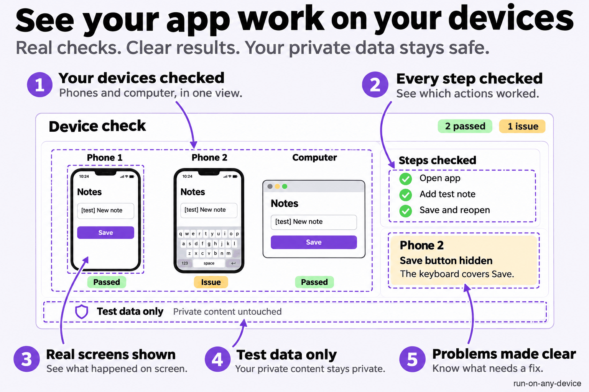

# Run your app on real devices, safely

Your agent runs the dev build on phones, simulators and desktop, drives it one tap at a time, and uses only test data. It keeps the machine healthy and never mixes up a dev build with a signed release.

Use it when:
- You want your agent to try a change on a real phone or simulator.
- Several agents might share devices or ports.
- A check must happen on a signed build, not the dev build.

Try it: "Run the app on the Android phone and check that the new settings screen saves."
