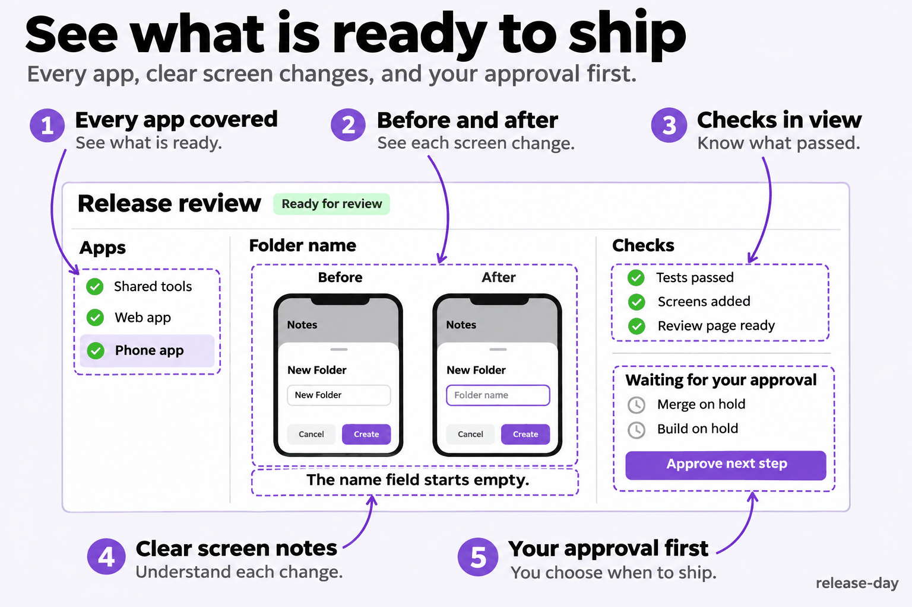

# Keep release branches and PRs clean

Your agent follows one set of release rules across every repo: one branch name, a passing tree, one push at a time, captioned screenshots and a screen review link in every PR. Nothing merges or ships until you say yes.

Use it when:
- A release spans several repos or a shared package.
- You are opening or updating a release PR.
- You want reviewers to see every changed screen without running the app.

Try it: "Prep the release PRs for this branch with captioned screenshots and the screen review link."
