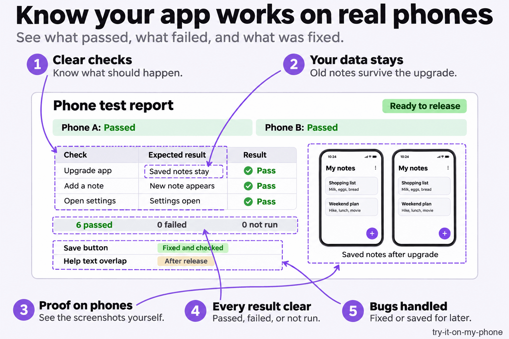

# Check a release by hand on real phones

Your agent writes a do-this, see-this checklist from the release diff, runs it one device at a time, and reports every check as pass, fail or not run. Every failure becomes a fix with a test or a logged item.

Use it when:
- A release is ready and you want it checked on real devices before it ships.
- An upgrade path or fresh install needs to be proven, not assumed.
- You want screenshots of each passed check in the PR.

Try it: "Hand test this release on my iPhone and Android phone and tell me what fails."
