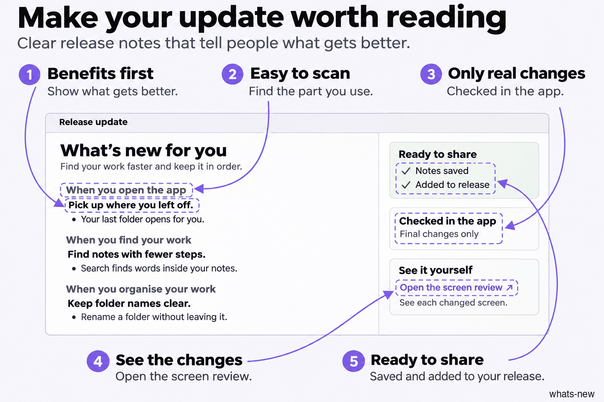

# Release notes your users will actually read

Your agent turns the notes from your screen review into short release notes, grouped by how people use the app and written for them, not for engineers. It saves them in the repo and puts them at the top of the release PR.

Use it when:
- A release is ready and you need a "What's new" that people will read.
- You reviewed screens with comments and want those turned into user-facing notes.
- The release PR needs a clear summary and links to the review pages.

Try it: "Write the release notes from the screen review comments and put them at the top of the release PR."
