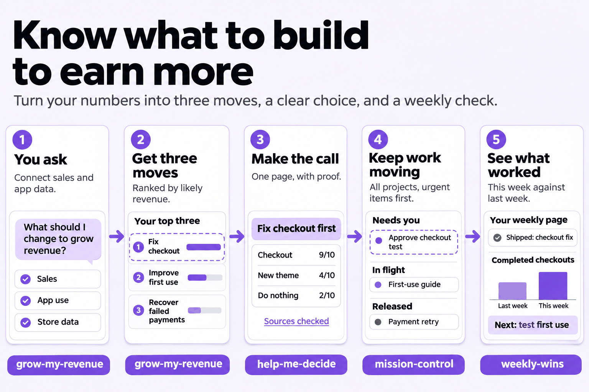

# Know what makes you money

You have Stripe, analytics and store numbers but no idea what to change. You get the three moves that should grow revenue most, and big calls laid out on one page.



| Skill | What you get |
| --- | --- |
| [**grow-my-revenue**](skills/grow-my-revenue) | Connect Stripe and your analytics. Get the three moves that grow revenue most. |
| [**help-me-decide**](skills/help-me-decide) | Any big decision on one page: the answer first, every claim sourced, options scored. |
| [**weekly-wins**](skills/weekly-wins) | What you shipped this week against last week, and what's next. |
| [**pick-the-best-ai-model**](skills/pick-the-best-ai-model) | The best AI models for your app on every device, backed by public benchmarks. |
| [**mission-control**](skills/mission-control) | One page of everything in flight across your projects, with what needs you on top. |

## Install just this set

```bash
npx skills add off-grid-ai/skills --skill grow-my-revenue help-me-decide weekly-wins pick-the-best-ai-model mission-control
```

Claude Code: `/plugin marketplace add off-grid-ai/skills` then `/plugin install off-grid-revenue@off-grid-ai`.
Codex: `codex plugin marketplace add off-grid-ai/skills` then `codex plugin add off-grid-revenue@off-grid-ai`.

Some of these skills call skills in other sets. To get everything working together, install every set (see the main README).

[All skills](../README.md)
