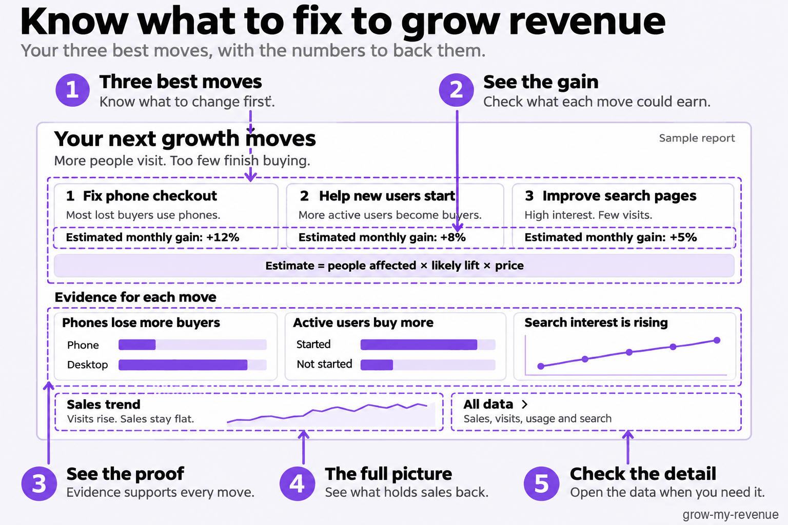

# Find the three changes that will grow your revenue

Your agent pulls every source you have (payments, analytics, app stores, search), lines it up against what you
shipped, and gives you three ranked moves with the money math. You get one dashboard page: the moves on top, the
charts that prove them below.

Use it when:
- Sales moved and you want to know why, not guess.
- You have data in five places and no time to read it all.
- You want to know which fix is worth the most before you build it.

Try it: "We sell through Stripe and track the site in PostHog. What should I change to grow revenue this month?"
