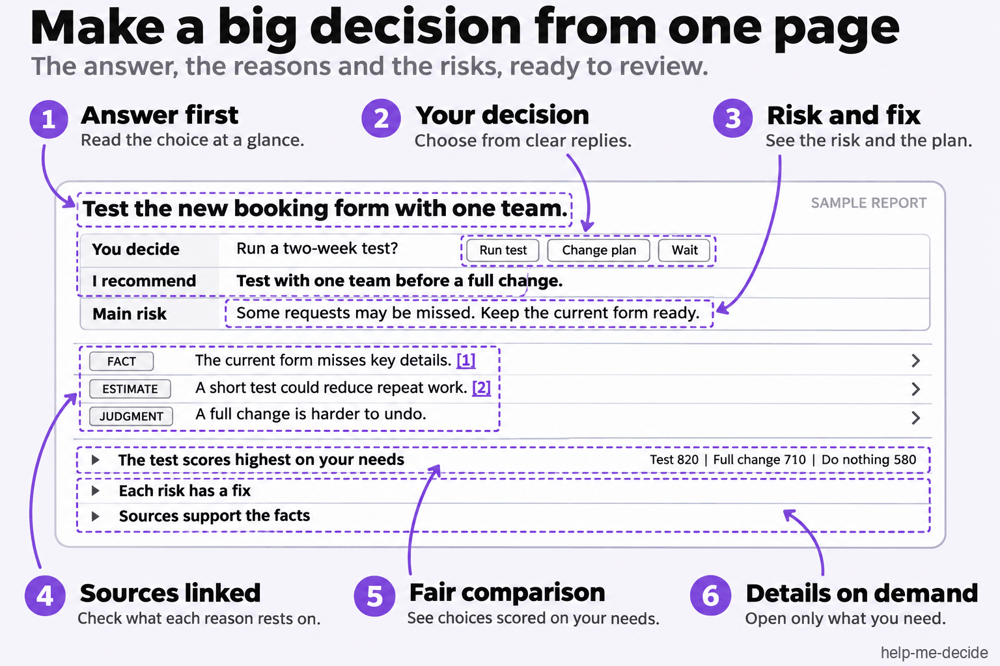

# Get a one-page decision report you can approve from the first screen

Your agent writes one page with the answer first, every claim linked to a source, at least three options scored on points you set, and separate reviewers checking the facts and the reasoning before you see it.

**Use it when**

- You have to pick between options and want the case laid out fairly.
- Someone asks you for a decision paper or board paper.
- You want a recommendation you can trust, not a confident guess.

**Try it:** "Help me decide whether to hire a growth lead, use an agency, or keep doing it ourselves. Write it up so I can decide."
