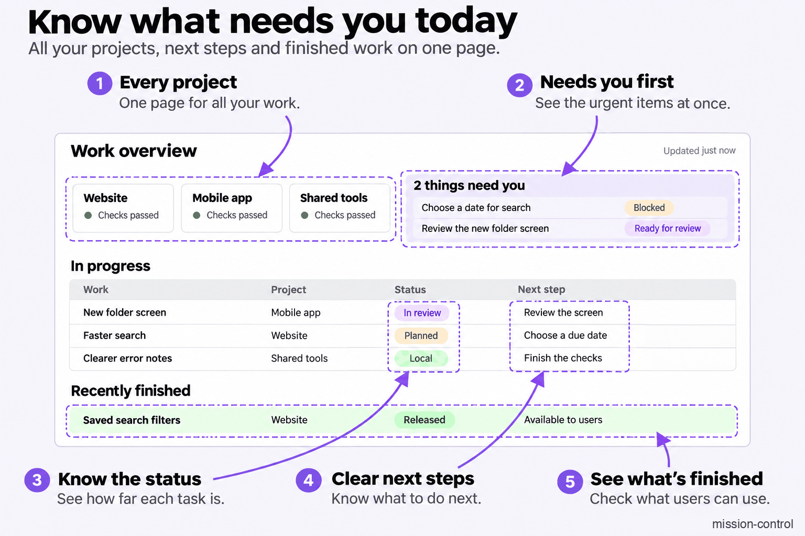

# See everything in flight across your repos on one page

Your agent builds one local page from git and GitHub: every branch, PR, CI run and release across your repos, with
what needs you at the top. It also keeps short notes per feature (goal, next step, blockers, due date) and can triage
your backlog against the real code.

Use it when:
- You work across several repos and lose track of what is where.
- You want to know what is blocked, failing or waiting on you, first thing.
- Your backlog has items nobody has checked are still real.

Try it: "Set up a dashboard for my three repos and tell me what needs me today."
