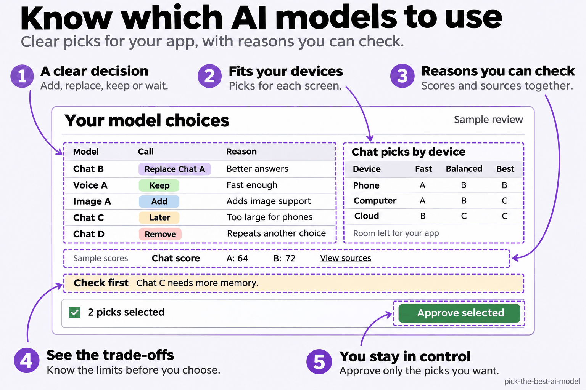

# Pick the right AI models for your app

Your agent reads which models your app uses today, researches what else could ship for each kind of model and each device, and hands you a sourced table of Add, Replace, Keep, Later and Remove calls. Once you approve, it writes the picks into your app's model list.

**Use it when**

- New models came out and you want to know if any beat what you ship.
- You are choosing models for a new feature such as transcription, voice or image generation.
- You need different picks for small and large devices.

**Try it:** "Which transcription and chat models should our app ship for phones with 8 GB and desktops with 16 GB?"
