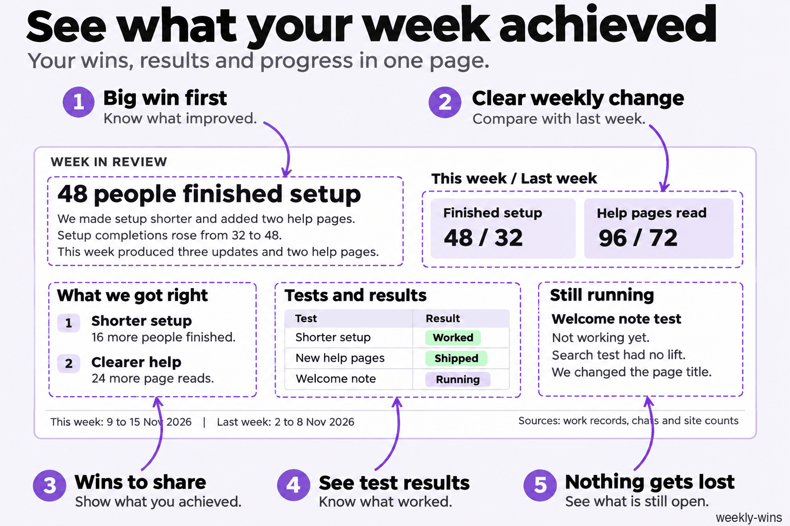

# Get a one-page debrief of this week against last week

Your agent reads your git history, your agent chats and whatever metrics you track, then writes one page: the bottom line first, what went right, the experiments and how each went, with last week's numbers beside this week's.

**Use it when**

- You have a weekly team, partner or investor meeting.
- You did a lot this week and want it counted, not remembered.
- You want to see which experiments worked and which are still running.

**Try it:** "Make the weekly debrief for our product team: what we shipped and how it did, against last week."
