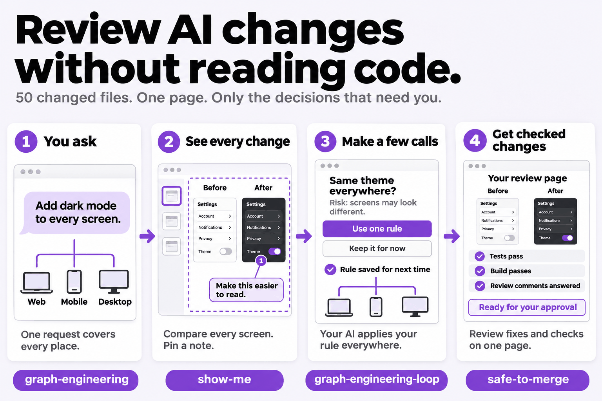

# Review like a senior engineer, without reading code

Your AI changes 50 files and you can't tell what broke. Every change gets a pass or fail against one clear bar, and every review comment gets answered and fixed before it merges.



| Skill | What you get |
| --- | --- |
| [**safe-to-merge**](skills/safe-to-merge) | Your pull request gets every review comment answered and fixed until it's safe to merge. |
| [**code-check**](skills/code-check) | A pass or fail on every change before it ships, against one clear bar. |
| [**never-twice**](skills/never-twice) | Every review teaches your AI, so the same mistake never comes back. |

## Install just this set

```bash
npx skills add off-grid-ai/skills --skill safe-to-merge code-check never-twice
```

Claude Code: `/plugin marketplace add off-grid-ai/skills` then `/plugin install off-grid-review@off-grid-ai`.
Codex: `codex plugin marketplace add off-grid-ai/skills` then `codex plugin add off-grid-review@off-grid-ai`.

Some of these skills call skills in other sets. To get everything working together, install every set (see the main README).

[All skills](../README.md)
