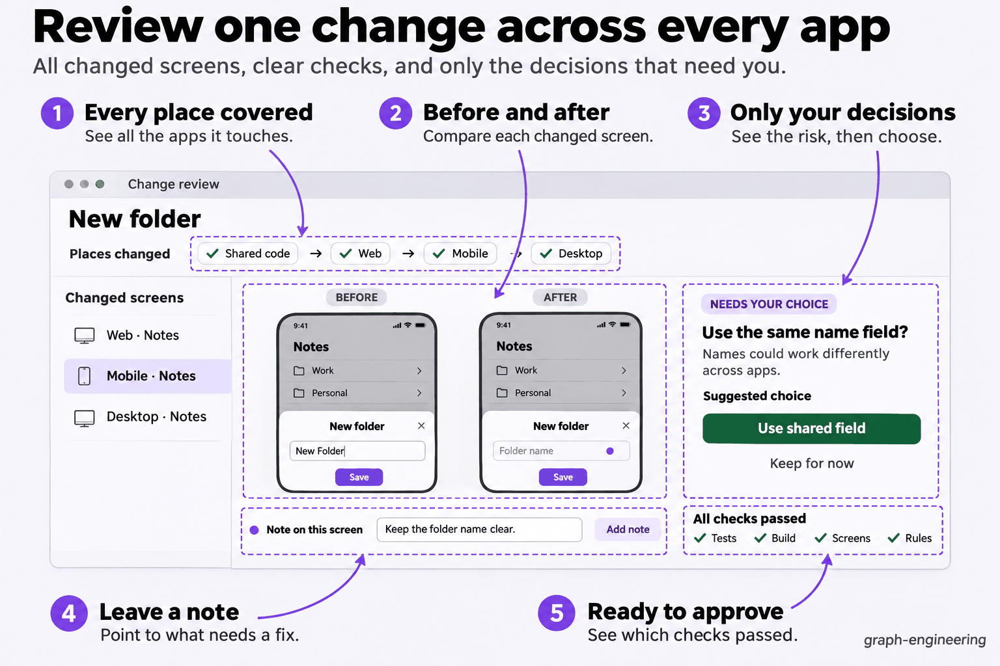

# See every place one change touches, and review it all on one page

Change one thing and your agent maps every place it lives across your web, mobile and desktop apps, makes the change in the right order, and hands you one page: every changed screen before and after with notes, and only the calls that need you.

## Use it when
- One app is enough: change a screen that shows up in several places and review every one of them at once.
- A feature lives in more than one app, and you want to change it everywhere at once.
- You want to know what a change touches before any code is written.
- Your agent changed a lot, and you want to review the result, not read the diff.
- You keep finding the same rule copied into several apps.

Try it: "Use graph-engineering to add a dark mode toggle to settings in the web, mobile and desktop apps."

Works with [graph-engineering-loop](../graph-engineering-loop), which learns from your calls. Needs [show-me](../show-me) for the page.

## What you need
- Python 3 (the change map script uses only the standard library).
- A way for your agent to screenshot your app: a browser it can drive for web apps, a simulator or device for phone apps.
- Claude Artifacts are optional. Without them the page opens as a local HTML file.
- For a change that lives in one place, the skill tells your agent to just make the fix.
