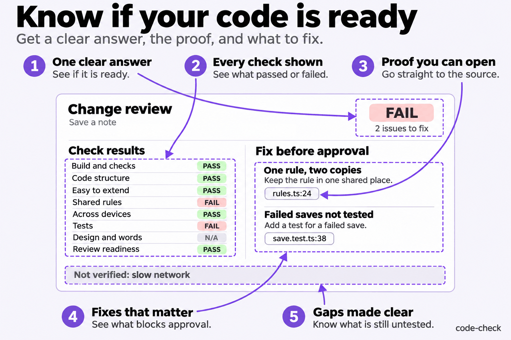

# Hold every change to one standard, with a pass or fail before it merges

One engineering bar for your agent's code: separation of concerns, one owner for every fact, one shared seam across platforms, and tests that prove what the user sees. Your agent plans against it, audits each diff against it dimension by dimension, and can install the quality gates that enforce it.

## Use it when
- A diff is ready and you want a pass or fail with evidence.
- You are designing a new subsystem and want it right the first time.
- A JavaScript or TypeScript repo has no linting, coverage or pre-push checks yet.

Try it: "Use code-check to audit this branch against main."

Gets sharper over time through [never-twice](../never-twice).
