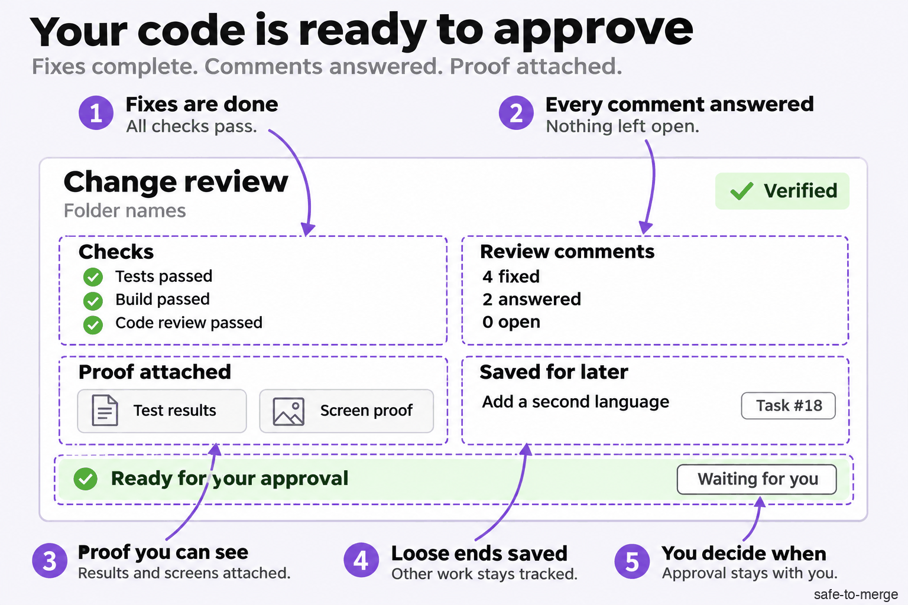

# Get every pull request to ready-to-merge, with each comment answered

Your agent audits its own diff, collects every review signal (AI review bots, coverage, static analysis, CI, human comments), answers each comment on its own thread, fixes behind your checks, and loops until nothing blocks. You only say when to merge.

## Use it when
- A PR has open review comments.
- You pushed to a PR and want the new feedback handled.
- You want a clear verdict: code, wired or verified.

Try it: "Use safe-to-merge on PR 42."

Uses [code-check](../code-check) as its bar and [never-twice](../never-twice) to keep the bar rising.
