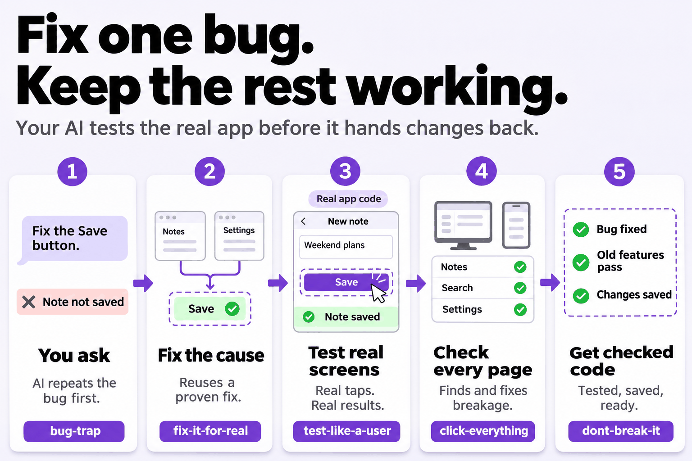

# Your AI stops breaking things that already worked

You fix one bug and two old features break. Every change gets tested by tapping through your app like a real user, with no mocks hiding the breakage.



| Skill | What you get |
| --- | --- |
| [**test-like-a-user**](skills/test-like-a-user) | Tests that open the real screen, tap the real button and check what you'd see. No mocks of your own code. |
| [**bug-trap**](skills/bug-trap) | Every bug gets a test that fails first, so it can't sneak back in. |
| [**dont-break-it**](skills/dont-break-it) | Your AI changes, checks and saves code so nothing half-done ships. |
| [**fix-it-for-real**](skills/fix-it-for-real) | It fixes the cause, not the symptom, and reuses what someone already solved. |
| [**click-everything**](skills/click-everything) | It clicks through every page of your web app and fixes what breaks. |

## Install just this set

```bash
npx skills add off-grid-ai/skills --skill test-like-a-user bug-trap dont-break-it fix-it-for-real click-everything
```

Claude Code: `/plugin marketplace add off-grid-ai/skills` then `/plugin install testing@off-grid-ai`.
Codex: `codex plugin marketplace add off-grid-ai/skills` then `codex plugin add testing@off-grid-ai`.

Some of these skills call skills in other sets. To get everything working together, install every set (see the main README).

[All skills](../README.md)
