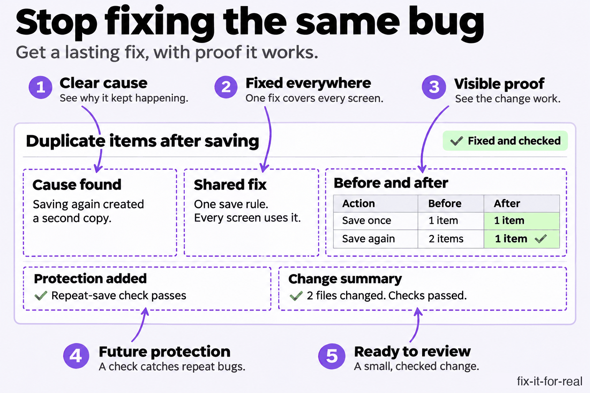

# Fix the real problem, not the symptom

Your agent reproduces each bug with a failing probe, looks for who already solved the general problem, and fixes the system instead of patching one case. It commits small checked changes, safely, even when several agents share one folder.

Use it when:
- The same bug keeps coming back after "fixes".
- Your agent hand-codes something an engine or library already does.
- Several agent sessions commit to one checkout and keep undoing each other.

Try it: "The units keep walking through buildings. Fix the real problem, not this one case."
