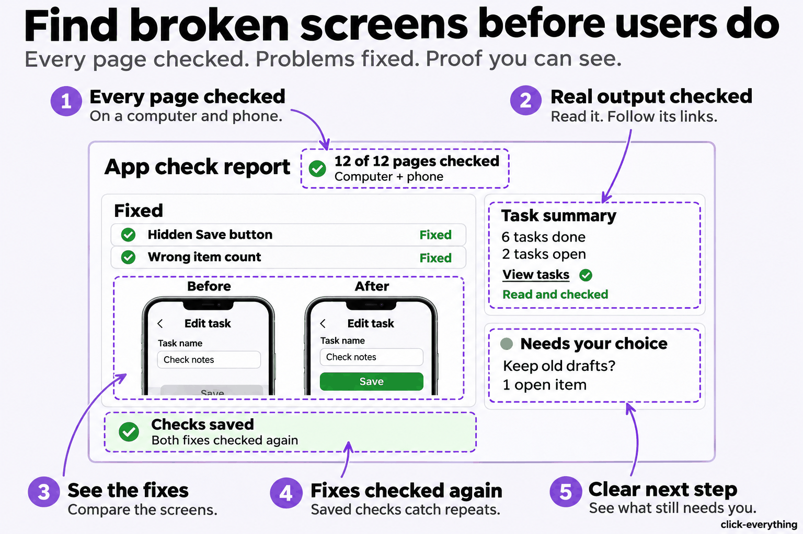

# Test your app one module at a time, the way a user sees it

Your agent lists every route from your router, screenshots every page and state, presses the buttons, makes the app produce real output and reads it, fixes what doesn't make sense, and adds end-to-end tests so each fix stays fixed. You get a report per module with real counts.

## Use it when
- Your agent has nothing else queued.
- You want a module checked by eye, not just by passing tests.
- Pages look fine but the answers, reports or results inside them might not be.

Try it: "Use click-everything on the billing module."
